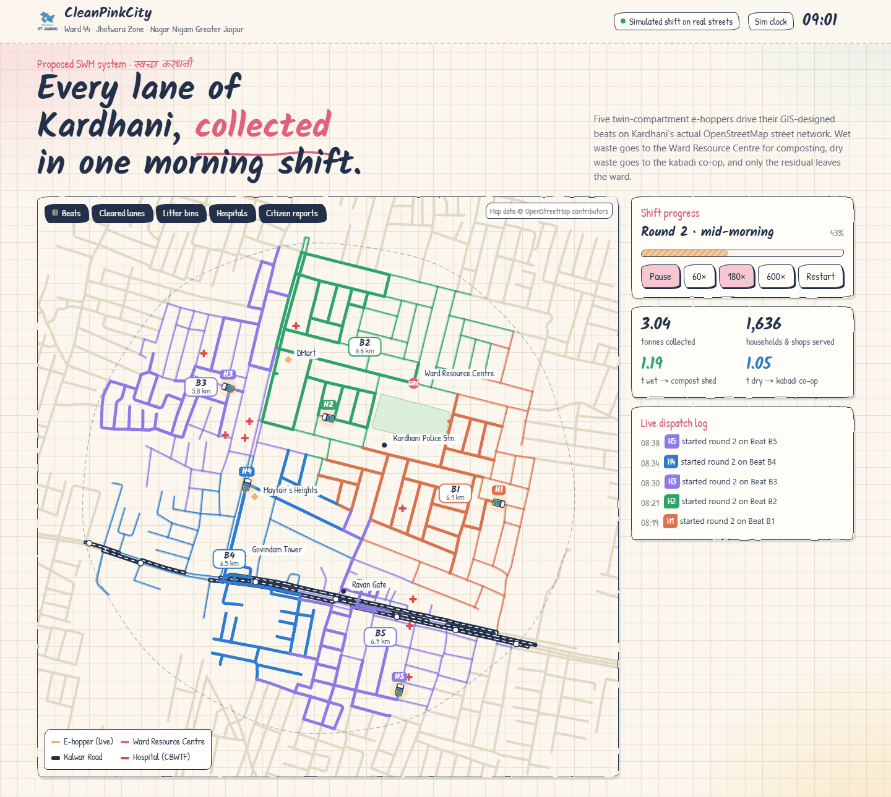
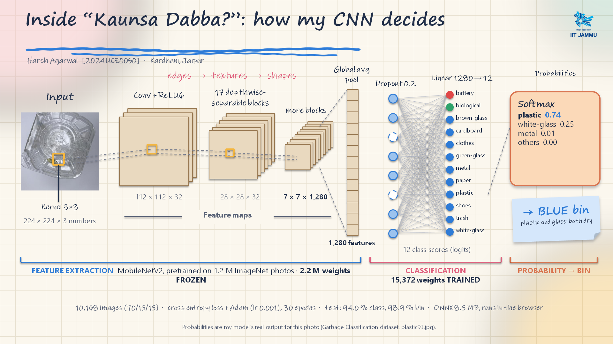
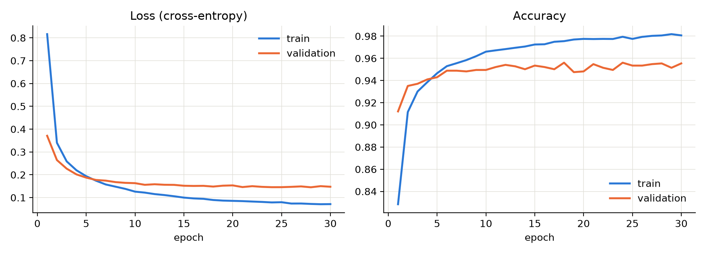
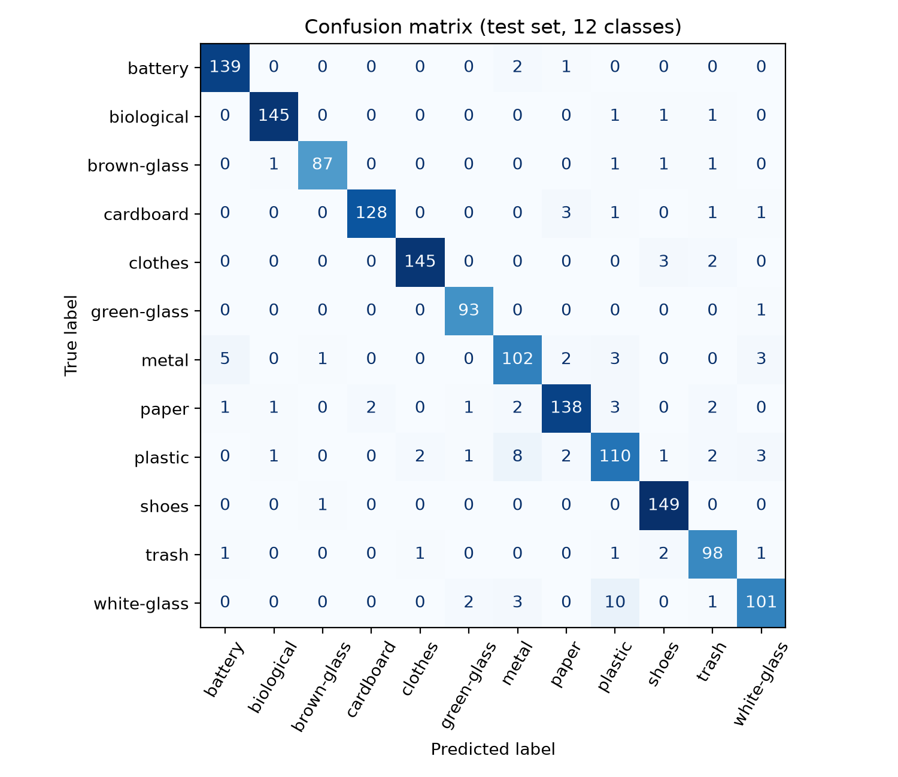

# CleanPinkCity

AI waste sorting and GIS route planning for a ward in Jaipur, the Pink City.

**Live demo:** [clean-pink-city-web.vercel.app](https://clean-pink-city-web.vercel.app/) · **Demo video:** [YouTube](https://youtu.be/MUE6mEVxti8)



A smart solid-waste-management system designed for Kardhani (Ward 44, Jaipur): a CNN that tells residents which bin an item goes in, a collection route planned on the ward's real street network, and a web app that brings both together.

## What it does

- **"Kaunsa Dabba?" AI bin sorter.** Snap or upload a photo of a waste item and get the right bin: green (wet), blue (dry) or red (hazardous). The model runs entirely in the browser, so photos never leave the device.
- **GIS route planning.** Plans door-to-door collection on the ward's OpenStreetMap street network and splits it into 5 balanced beats for the collection vehicles.
- **Web app.** A static site that combines the bin sorter (live camera or upload), the route maps and a citizen complaint map, drawn in the same hand-drawn notebook style as the project presentation.

## How the model works

- **Backbone:** MobileNetV2 pretrained on ImageNet, kept **frozen** (2.2M weights), used as a feature extractor that turns each photo into 1,280 numbers.
- **Head:** the only trained part, `Dropout(0.2) → Linear(1280 → 12)`, about 15k weights.
- **Training:** 12 waste classes, CrossEntropyLoss, Adam (lr 1e-3, weight decay 1e-4), batch 64, 30 epochs on CPU (about 10 min), with augmentation (random resized crop, horizontal flip, ±15° rotation, colour jitter).
- **Bin mapping:** biological → green, battery → red, the other 10 classes → blue.
- **Deployment:** exported to ONNX (8.5 MB) and run with ONNX Runtime Web; the browser only resizes the photo to 224×224 and scales it to 0–1.



## Results

Evaluated on a held-out test set of 1,526 images.

| Metric | Score |
|---|---|
| Accuracy (12 classes) | **94.0 %** |
| Macro F1 | **0.939** |
| Correct bin (3 bins) | **98.9 %** |
| Best validation accuracy | 95.6 % |

Data: 10,168 images (up to 1,000 per class), split 70/15/15 into train 7,117 / val 1,525 / test 1,526. Even when the model confuses two classes, both usually belong in the same bin, which is why bin accuracy is higher than class accuracy.

| Training curves | Confusion matrix (test set) |
|---|---|
|  |  |

## Route planning

The study area is a 650 m radius around Kardhani, approximating Ward 44. Its OpenStreetMap street network, loaded with OSMnx and analysed with NetworkX, has 399 junctions, 557 street segments and 31.7 km of streets. A collection vehicle has to cover every street, so the route is planned as a Chinese Postman problem: the 318 odd-degree junctions are paired greedily by shortest path, which adds 12.4 km of repeat driving. The full route is 44.1 km (72 % route efficiency) and is split into 5 beats of about 6 km each, one per collection vehicle.

## Tech stack

- **Model:** PyTorch, torchvision (MobileNetV2), scikit-learn, ONNX
- **In-browser inference:** ONNX Runtime Web (WebAssembly, bundled in `web/vendor/` so the demo works offline)
- **GIS:** OSMnx, NetworkX, GeoPandas, Shapely, Matplotlib
- **Web app:** plain HTML, CSS and JavaScript split into small files (`web/css/`, `web/js/`), no framework or build step; complaint reports are kept in the browser's localStorage

## Repository layout

```
model/   training notebook, notebook build script, plots, metrics, trained head, ONNX export + labels
gis/     street-network routing analysis and ward design calculations, with their outputs
web/     the web app, deployable as a static site (index.html at its root)
           css/ styles (doodle.css holds the hand-drawn theme), js/ one file per feature, assets/ images
docs/    images used in this README
```

## Run locally

**Web app.** It has to be served over HTTP (opening the file directly blocks the model from loading):

```bash
cd web
python -m http.server 8000
# open http://localhost:8000
```

On Windows you can also double-click `web/Start_Demo.bat`.

**Training notebook.**

```bash
pip install -r requirements.txt jupyter
```

1. Download the [Garbage Classification dataset](https://www.kaggle.com/datasets/mostafaabla/garbage-classification) from Kaggle.
2. Unzip it so the 12 class folders sit in `model/data/garbage_classification/` (for example `model/data/garbage_classification/battery/`).
3. Open `model/Waste_Classifier_CNN.ipynb` from inside `model/` and run all cells. It writes plots and metrics to `model/outputs/` and the ONNX model and labels to `model/export/`. To update the web app, copy `model/export/waste_mobilenetv2.onnx` into `web/`.

**Route planning.** Run `python gis.py` from inside `gis/`. It needs two OpenStreetMap files that are not included in the repo: `kardhani.graphml` (the street network) and `amen.gpkg` (amenities with `name` and `amenity` tags, used to place facilities on the maps). Re-download them with OSMnx around the centre point `26.9525358, 75.7104088`: get the street network with `ox.graph_from_point` and save it with `ox.save_graphml`, then get the amenities with `ox.features_from_point` and save them with `GeoDataFrame.to_file`. Use a download radius larger than the 650 m study area. OSM data changes over time, so a fresh download can give numbers slightly different from `gis/gis_stats.json`. `design_calc.py` needs no input files and writes `numbers.json`.

## Limitations and next steps

- **Dataset mismatch.** The model is trained on a public dataset of clean, single-item photos, not Indian street waste. The next step is to fine-tune it on locally collected photos.
- **3 bins, not 4.** The model sorts into wet, dry and hazardous. India's SWM Rules 2026 require 4 streams (wet, dry, sanitary, special care), and sanitary waste is not covered yet; it needs its own class and data.
- **Known confusion.** White glass and plastic are the pair the model mixes up most often.
- **Complaints stay local.** Reports in the web app are stored in the browser's localStorage, so a real deployment would need a shared backend.

## Context

Built as my individual part of a course project for Solid Waste Management (Civil Engineering) at IIT Jammu, October 2026.

## Credits

- Dataset: [Garbage Classification (12 classes)](https://www.kaggle.com/datasets/mostafaabla/garbage-classification) by Mostafa Mohamed on Kaggle: 15,520 images, of which 10,168 were used here.
- Street network and amenities: © [OpenStreetMap](https://www.openstreetmap.org/copyright) contributors.
- Pretrained MobileNetV2 weights from torchvision.
